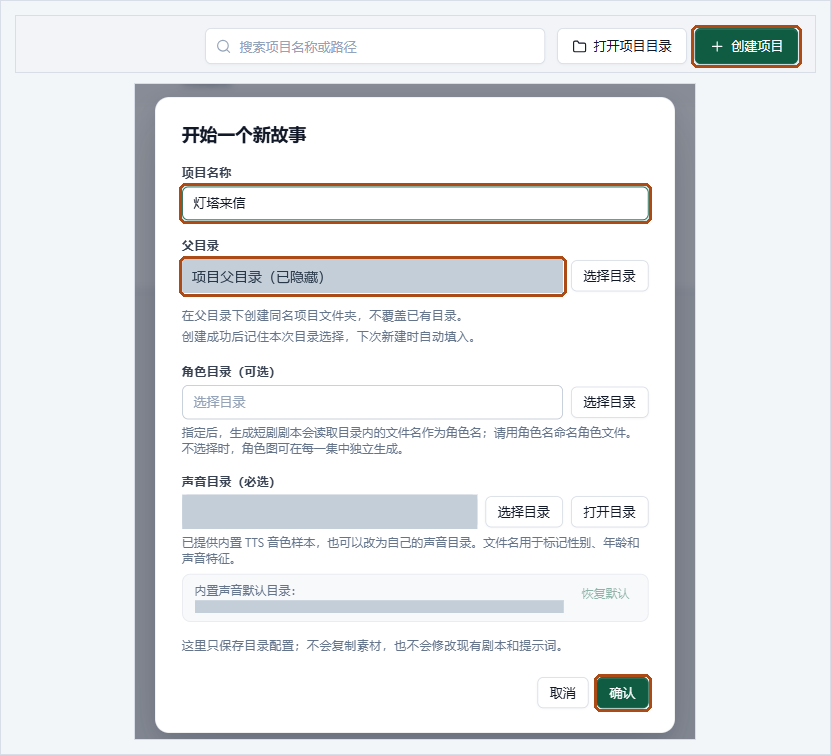
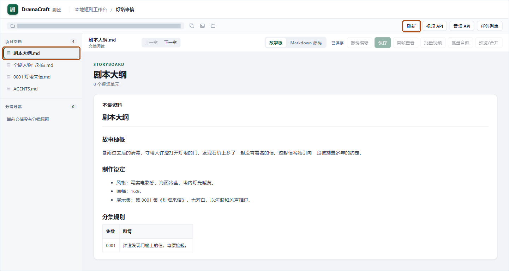
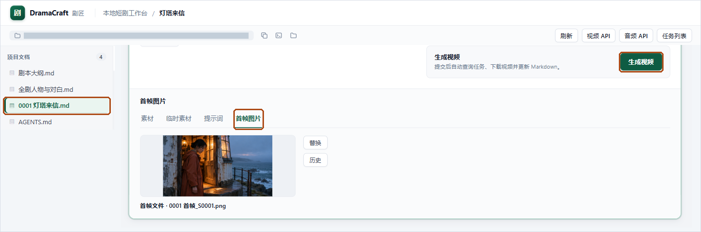
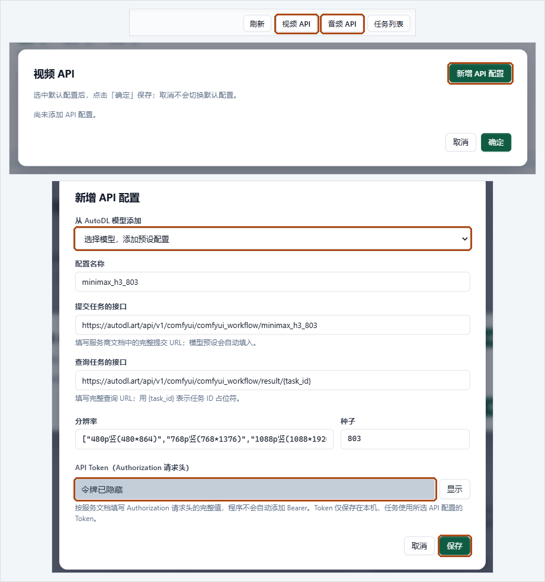
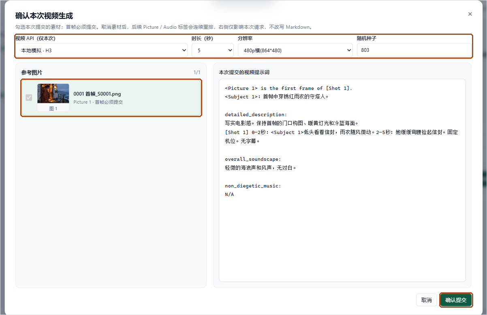
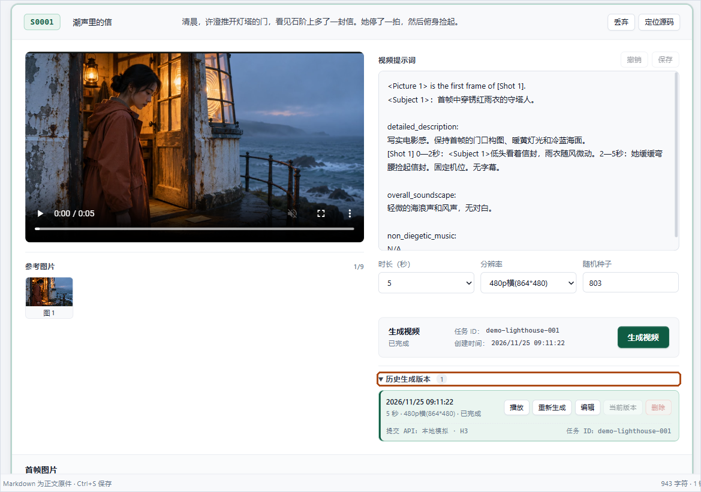

# DramaCraft · 剧匠

面向 AI 短剧制作的 Windows 本地工作台。用外部 AI Agent 编写剧本、整理分镜和生成图片，再回到剧匠管理素材、生成视频、选择版本并合并分集。

剧本和提示词以 Markdown 保存在自己的项目文件夹中，可随时用编辑器修改，无需部署后端。文本创作和图片生成在 Codex 等外部 Agent 中完成；剧匠提供故事板和音视频任务管理。

## 使用流程

**创建项目 → 准备剧本 → 逐集整理分镜 → 生成图片 → 配置 API → 生成视频 → 合并与剪辑**

### 1. 创建项目

首页的项目表格支持按名称或路径搜索。点击项目名称进入工作台，或在工具栏点击「打开项目目录」载入已有项目。

在首页工具栏点击「创建项目」，选择父目录并填写项目名称。创建成功后会记住父目录、角色目录和声音目录，下次新建自动填入。声音目录首次使用客户端内置样本，也可选择自己的目录；下方始终显示内置声音的默认路径，可点击「恢复默认」找回。角色目录可留空，已有角色图时用角色名命名文件。



创建后，在 Codex 等支持本地文件读写的 Agent 中打开**同一个项目文件夹**。项目已包含：

| 文件 | 用途 |
| --- | --- |
| `AGENTS.md` | 项目创作流程、分集格式和素材命名规则 |
| `剧本大纲.md` | 故事设定与分集规划 |
| `全剧人物与对白.md` | 人物登记与逐集完整对白 |
| `assets.json` | 由 Agent 维护的跨集角色、素材索引 |

### 2. 准备剧本：选择一种方式

#### 方式一：与 Agent 从零创作

在 Codex 中打开刚创建的项目文件夹并新建对话。把下面的提示词发给 Codex，让它先读项目的 `AGENTS.md`，再依次确认题材方向、故事大纲和全剧对白。

```text
请先阅读项目根目录的 AGENTS.md，按其中的流程与我完成短剧创作。
先讨论题材、故事方向、画面风格、集数、单集时长、画幅及是否使用旁白。
方向确定后写入《剧本大纲.md》；大纲确认后，完成《全剧人物与对白.md》。
先保留可连读的完整对白正文，再分配到视频单元，暂不生成图片或视频。
```

#### 方式二：使用小云雀已有剧本

先在小云雀的「短剧 Agent → 剧本创作」中完成剧本，再下载「分集大纲」与「剧本正文」，放入项目子目录，例如 `原始剧本/`。将这两份材料交给 Agent 整理为剧匠的制作文档：

```text
请阅读项目根目录的 AGENTS.md，以及“原始剧本”目录中的分集大纲和剧本正文。
提取并整理到《剧本大纲.md》和《全剧人物与对白.md》。
保留原有分集、事件顺序、人物、台词及必要动作，不另写故事，不重新润色对白。
先完成整理，供我确认，暂不生成分镜、图片或视频。
```

整理时一并告诉 Agent 所需的画面风格、旁白选择、画幅和分辨率。小云雀下载的文件是创作依据，需要经 Agent 整理为项目格式后，再进入故事板制作。

Codex 写入文件后，回到剧匠点「刷新」，从左侧打开《剧本大纲》或《全剧人物与对白》查看结果。下图使用虚构项目《灯塔来信》。



### 3. 逐集整理分镜

两种方式都在大纲和对白确认后，按相同流程继续。在 Agent 中输入：

```text
大纲和全剧人物与对白已确认，请按 AGENTS.md 的 v1 格式编写第0001集分镜。
保留已确认的剧情、对白原词和顺序，按发声与动作所需时间拆分视频单元。
写齐角色、素材、首帧及视频提示词，核对文件名和引用，并更新 assets.json。
本轮只编写文稿，不调用图片、配音或视频生成。
```

先检查第0001集，再按集顺序继续。正式分集使用 `0001 集名.md` 这样的文件名；每个 `S` 编号对应一次视频生成，可包含多个剪辑镜头。每集完成后先登记新增资产，再写下一集，便于复用同一角色和场景。

### 4. 在 Agent 中生成图片

分镜文稿完成后，使用具备图片生成能力的 Agent（例如已启用 imagegen 的 Codex），按**基础角色图与独立道具图 → 角色造型变体图 → 空间机位图与场景/其余素材图 → 首帧图（含分步临时素材）**的顺序生成。可分三轮执行：

```text
请依据 AGENTS.md 和第0001集分镜文稿，使用 imagegen 生成本集尚缺的基础角色图。
按文稿指定的文件名和位置保存，复用已有角色图，不覆盖已有文件。
```

```text
继续生成本集尚缺的素材图：先生成独立道具图与空间机位图，再依赖基础角色图/道具图生成角色造型变体图，依赖空间机位图生成场景外观图。按文稿中的提示词、文件名和位置保存。
```

```text
角色图和素材图已准备好，请按分镜顺序生成本集所有镜头的独立首帧。
读取每镜提示词及其引用的角色、素材图片，按文稿指定的文件名和位置保存。
若首帧提示词包含分步生图指令，请严格按步骤依次生成中间临时素材和最终首帧；临时素材按文档指定的文件名保存在项目根目录，保留不删除。
```

后续分集沿用同样顺序，只补齐新增或缺失的图片。分步生图产生的临时素材可在故事板分镜卡片的「临时素材」标签页中预览，并支持单张手动上传或替换。

图片保存到文稿指定位置后，回到剧匠点「刷新」并打开该集。在对应分镜下方切到「首帧图片」标签，核对预览和文件名。下图的演示首帧由 Codex 中的 imagegen 生成。



### 5. 配置 AutoDL API

剧匠通过 AutoDL Art 的 ComfyUI API 生成视频和配音。首次使用前，请先登录 AutoDL Art。

- 查看可用工作流，点开对应条目可查看工作流 ID 和接口参数。[AutoDL Art ComfyUI 工作流列表](https://autodl.art/large-model/comfyui)
- 点击「创建新令牌」，分组选择 `ComfyUI`，创建后复制密钥。回到剧匠，在对应 API 配置的「API Token（Authorization 请求头）」中直接粘贴密钥。[AutoDL Art 令牌管理](https://autodl.art/large-model/tokens)

进入项目后，点击右上角「视频 API」→「新增 API 配置」，在「从 AutoDL 模型添加」中选择预设。预设会填入提交和查询地址。填入令牌并点「保存」，回到列表选中要使用的默认配置，再点「确定」。



需要独立配音时，在右上角「音频 API」中新增 IndexTTS2 配置，填入 AutoDL 的 ComfyUI 令牌，保存并设为默认。再通过「批量音频」按角色生成台词音频，供后期编排。

### 6. 生成视频

1. 打开分集，在故事板中检查首帧、参考素材、视频提示词和参数，点击分镜卡片上的「生成视频」。
2. 在确认窗口核对本次使用的 API、时长、分辨率、参考素材和提示词，点击「确认提交」。

   

3. 任务完成后，剧匠会下载视频并设为当前版本。在「历史生成版本」可播放、切换版本、裁切片头片尾或导出尾帧。裁切会覆盖对应视频文件。
4. 点击「合并」，勾选本集需要的当前视频，按分镜顺序拼接。需要字幕、音乐或进一步剪辑时，再导入剪映等工具。

确认窗口和下方结果使用本地模拟接口演示，画面为演示样片。



## 许可

DramaCraft 自有源代码和配套文档采用 [MIT 许可证](LICENSE)。

内置音色样本是在 Codex 中生成的，随应用提供，供创作者参考角色音色。音色样本及其他第三方或私人素材各自适用其许可或使用条件。

桌面构建使用 FFmpeg essentials sidecar（GPL），以独立子进程调用。FFmpeg 二进制文件不纳入 Git。
