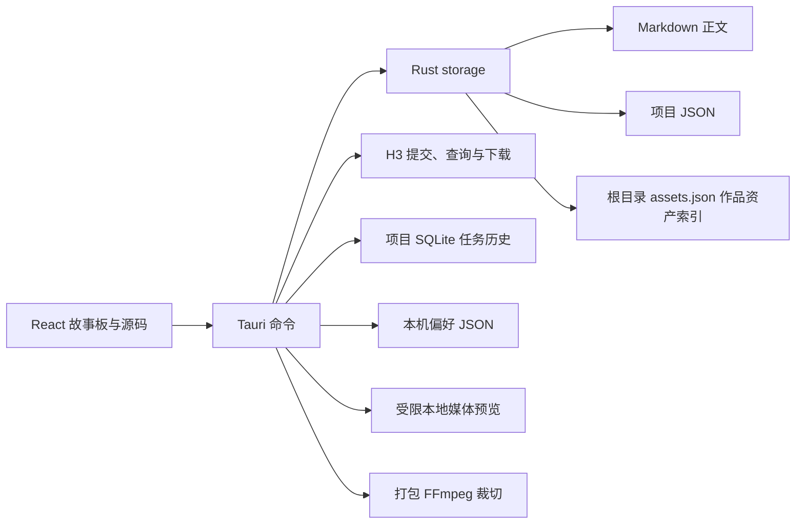

# 02 系统架构

## 当前架构

前端采用 React、TypeScript、Vite；remark 语法树仅用于存储格式解析和源码定位。`episode.ts` 将 v1 固定字段与旧格式表格转换为剧集、角色绑定、素材和台词对象；故事板与分镜导航消费这些对象，不渲染剧集 Markdown。普通文档的阅读视图仍使用 react-markdown 与 GFM。界面默认中文，主要文案集中在 `src/i18n.ts`。Rust 负责目录管理、哈希、原子写入、元数据和媒体路径解析，通过 Tauri IPC 暴露能力。

业务文件操作位于 `src-tauri/src/storage.rs`，IPC 和会话位于 `src-tauri/src/lib.rs`。前端不直接访问文件系统。每次打开返回临时项目句柄，命令据此查找已打开的根目录；便携项目 ID 与会话句柄分离。

## IPC 接口

故事板解析位于 `src/storyboard.ts`，界面位于 `src/BoardView.tsx`。语法树仅用于定位顶层分镜、字段和素材；卡片与源码共用文本草稿，不序列化整棵树。`parseStoryboard` 返回卡片、非分镜区间和诊断；`fieldPatch`、新增/删除/移动操作产生带完整草稿前置条件的 `SourcePatch`，`applySourcePatch` 拒绝过期草稿。`generation.rs` 负责 H3 协议、本地素材编码、SQLite 历史及结果下载，不保存正文副本。

新打开的文档默认故事板/阅读视图；源码模式只在当前文档内保留。旧 `previewVisible` 偏好及相关 IPC 为兼容保留，但不控制新界面。素材在接近可视区域时加载，折叠的次要素材按展开状态挂载，视频不自动播放。

| 命令 | 输入与结果 |
|---|---|
| inspect_directory | 目录路径 → 候选作品；已有项目或直接含正文时返回空列表 |
| create_project / open_project | 父目录及名称 / 根目录 → 句柄、根目录、项目元数据、提示 |
| close_project | 句柄 → 释放会话 |
| scan_project | 句柄 → 相对文档路径及扫描诊断 |
| read_document | 句柄、相对路径 → 文本、SHA-256、只读标记 |
| read_asset_index | 句柄 → 根目录 assets.json 原文；旧项目无索引时返回空值 |
| save_document | 句柄、相对路径、文本、expectedHash → 新快照或冲突 |
| create_document | 句柄、相对路径、文本 → 新快照，禁止覆盖 |
| resolve_media / open_media | 句柄、来源文档、引用 → 状态及媒体路径 / 系统打开 |
| get_preferences / set_preview_visible | 读取最近项目及旧预览偏好 / 兼容旧预览设置；故事板不使用此设置 |
| get/set_generation_settings | 读取或保存 H3 Base URL；Authorization 读写本机应用偏好 JSON |
| get_generation_authorization | 用户点击显示时读取指定配置的 Authorization |
| submit_generation / poll_generation | 构建 H3 请求并记录 task_id / 查询状态并下载完成结果 |
| generation_history | 文档与镜号 → 最近 50 条任务及本地版本 |
| import_generation_media | 将用户选择的参考素材复制到分集文档旁并返回相对文件名 |
| trim_media | 用打包的 FFmpeg 按入点/出点裁切项目内 MP4，覆盖原文件，不改 Markdown |
| merge_episode | 按勾选分镜顺序拼接当前视频，写成 `0001 merge_时间戳.mp4`，并留下合并任务记录 |

错误统一返回 `code` 与 `message`。前端串行执行文件操作，避免切换、刷新与保存结果相互覆盖。

## 安全与限制

应用仅加载自己的前端。Markdown 禁用原始 HTML 执行，正文链接不导航，图片不自动请求网络。媒体面板只解析支持的本地媒体扩展名，通过 Rust 授予具体文件的预览权限；系统打开操作由用户点击触发。

写入拒绝绝对文档路径、父级跳转、隐藏目录、Windows 保留名称与链接逃逸。素材可只读引用项目外部文件。项目中的 AGENTS.md 是普通内容，不执行其指令。当前会话不是针对同时恶意替换目录的操作系统安全边界。
