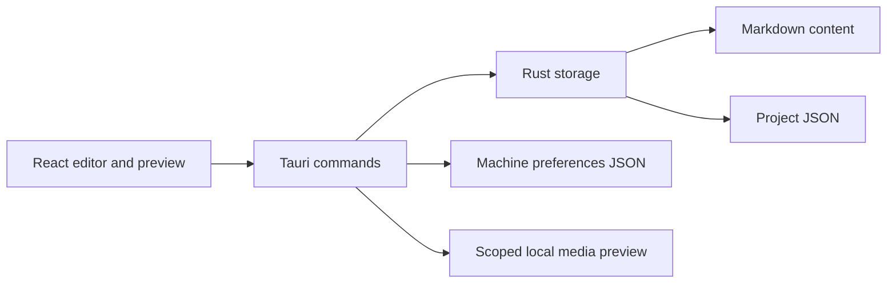

# 02 Architecture

[简体中文](../zh-CN/02-architecture.md) · [Index](../README.md)

## Implemented

The frontend uses React, TypeScript and Vite. A remark syntax tree supplies navigation; react-markdown with GFM renders tables and code blocks. The UI defaults to Chinese with primary copy centralized in `src/i18n.ts`. Rust owns directories, hashing, atomic writes, metadata and media path resolution, exposed through Tauri IPC.

File business logic lives in `src-tauri/src/storage.rs`; IPC and sessions live in `src-tauri/src/lib.rs`. The frontend never directly accesses the filesystem. Opening returns a temporary handle mapping to the opened root. Portable project IDs are separate from session handles.

## IPC interfaces

| Command | Inputs and results |
|---|---|
| inspect_directory | Directory → candidates; empty for a recognized project or direct content |
| create_project / open_project | Parent and name / root → handle, root, metadata, warning |
| close_project | Handle → release session |
| scan_project | Handle → relative document paths and scan diagnostics |
| read_document | Handle, relative path → text, SHA-256, read-only flag |
| save_document | Handle, relative path, text, expectedHash → new snapshot or conflict |
| create_document | Handle, relative path, text → snapshot; never overwrites |
| resolve_media / open_media | Handle, source document, reference → status and media path / system open |
| get_preferences / set_preview_visible | Read recents and preview preference / update preview visibility |

Errors contain `code` and `message`. The frontend serializes file operations so navigation, refresh and saves do not apply results out of order.

## Safety and limits

The application loads its own frontend. Markdown does not execute raw HTML, document links do not navigate, and images do not trigger network requests. The asset panel resolves supported local media extensions and grants preview access to individual files through Rust. Opening a file in its system application requires a user click.

Writes reject absolute document paths, parent traversal, hidden directories, Windows reserved names and linked-path escapes. Assets can reference external files read-only. Project AGENTS.md files are ordinary content, not instructions. Sessions are not an OS security boundary against a malicious process concurrently swapping directories.

## Planned

Rust provider adapters will perform model requests, with task scheduling independent of views. Adding SQLite must retain the file storage module as the sole content authority, without dual-writing editable document bodies.
