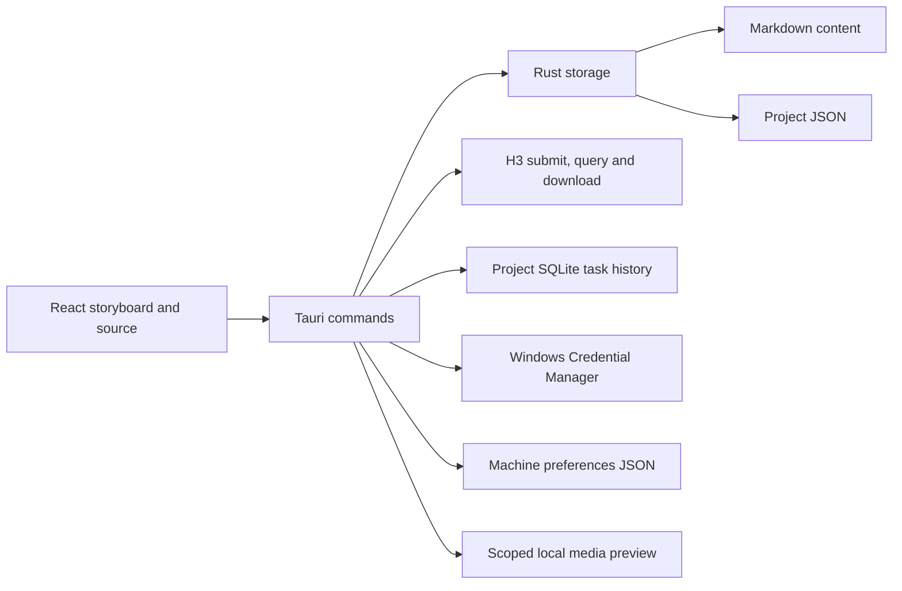

# 02 Architecture

[简体中文](../zh-CN/02-系统架构.md) · [Index](../README.md)

## Implemented

The frontend uses React, TypeScript and Vite. A remark tree handles storage-format parsing and source locations only. `episode.ts` adapts v1 fields and legacy tables into episode, character-binding, asset and dialogue objects; storyboard views and navigation consume these objects rather than rendering episode Markdown. Ordinary documents still use react-markdown/GFM in reading view. The UI defaults to Chinese with primary copy centralized in `src/i18n.ts`. Rust owns directories, hashing, atomic writes, metadata and media path resolution, exposed through Tauri IPC.

File business logic lives in `src-tauri/src/storage.rs`; IPC and sessions live in `src-tauri/src/lib.rs`. The frontend never directly accesses the filesystem. Opening returns a temporary handle mapping to the opened root. Portable project IDs are separate from session handles.

## IPC interfaces

Storyboard parsing lives in `src/storyboard.ts`, with its UI in `src/BoardView.tsx`. The AST only locates top-level cards, fields and assets; cards and source share one text draft without serializing the whole tree. `parseStoryboard` returns cards, non-shot ranges and diagnostics. `fieldPatch` and add/delete/move operations produce a `SourcePatch` with a full-draft precondition; `applySourcePatch` rejects stale drafts. `generation.rs` owns the H3 protocol, local-media encoding, SQLite history and result download without storing document bodies.

Newly opened documents default to storyboard/reading view; source mode is retained only within the current document. The old `previewVisible` preference and IPC remain for compatibility but do not control the new UI. Assets load near the viewport, secondary media mounts when expanded, and videos do not autoplay.

| Command | Inputs and results |
|---|---|
| inspect_directory | Directory → candidates; empty for a recognized project or direct content |
| create_project / open_project | Parent and name / root → handle, root, metadata, warning |
| close_project | Handle → release session |
| scan_project | Handle → relative document paths and scan diagnostics |
| read_document | Handle, relative path → text, SHA-256, read-only flag |
| save_document | Handle, relative path, text, expectedHash → new snapshot or conflict |
| create_document | Handle, relative path, text → snapshot; never overwrites |
| resolve_media / open_media | Handle, source document, reference → status and media path / system open |
| get_preferences / set_preview_visible | Read recents and legacy preview preference / retain legacy settings compatibility; unused by the storyboard |
| get/set_generation_settings | Read or save the H3 Base URL; Authorization uses Windows Credential Manager |
| submit_generation / poll_generation | Build and record an H3 request / query status and download a completed result |
| generation_history | Document and shot ID → 50 most recent jobs and local versions |
| import_generation_media | Copy a user-selected reference beside the episode and return its relative filename |

Errors contain `code` and `message`. The frontend serializes file operations so navigation, refresh and saves do not apply results out of order.

## Safety and limits

The application loads its own frontend. Markdown does not execute raw HTML, document links do not navigate, and images do not trigger network requests. The asset panel resolves supported local media extensions and grants preview access to individual files through Rust. Opening a file in its system application requires a user click.

Writes reject absolute document paths, parent traversal, hidden directories, Windows reserved names and linked-path escapes. Assets can reference external files read-only. Project AGENTS.md files are ordinary content, not instructions. Sessions are not an OS security boundary against a malicious process concurrently swapping directories.

## Planned

Text models, other video providers, background task scheduling, cancellation and serialized multi-job updates remain separate extensions. The file storage module remains the sole content authority without dual-writing editable document bodies.
