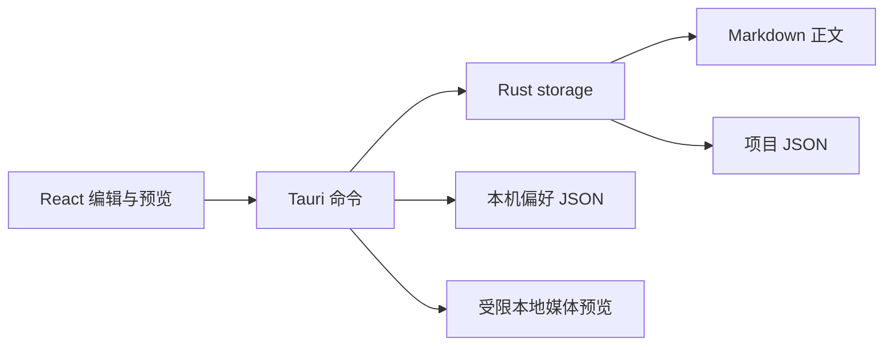

# 02 系统架构

[English](../en/02-architecture.md) · [目录](../README.md)

## 已实现

前端采用 React、TypeScript、Vite；Markdown 使用 remark 语法树生成导航，react-markdown 与 GFM 渲染表格和代码块。界面默认中文，主要文案集中在 `src/i18n.ts`。Rust 负责目录管理、哈希、原子写入、元数据和媒体路径解析，通过 Tauri IPC 暴露能力。

业务文件操作位于 `src-tauri/src/storage.rs`，IPC 和会话位于 `src-tauri/src/lib.rs`。前端不直接访问文件系统。每次打开返回临时项目句柄，命令据此查找已打开的根目录；便携项目 ID 与会话句柄分离。

## IPC 接口

| 命令 | 输入与结果 |
|---|---|
| inspect_directory | 目录路径 → 候选作品；已有项目或直接含正文时返回空列表 |
| create_project / open_project | 父目录及名称 / 根目录 → 句柄、根目录、项目元数据、提示 |
| close_project | 句柄 → 释放会话 |
| scan_project | 句柄 → 相对文档路径及扫描诊断 |
| read_document | 句柄、相对路径 → 文本、SHA-256、只读标记 |
| save_document | 句柄、相对路径、文本、expectedHash → 新快照或冲突 |
| create_document | 句柄、相对路径、文本 → 新快照，禁止覆盖 |
| resolve_media / open_media | 句柄、来源文档、引用 → 状态及媒体路径 / 系统打开 |
| get_preferences / set_preview_visible | 读取最近项目和预览偏好 / 更新预览显示状态 |

错误统一返回 `code` 与 `message`。前端串行执行文件操作，避免切换、刷新与保存结果相互覆盖。

## 安全与限制

应用仅加载自己的前端。Markdown 禁用原始 HTML 执行，正文链接不导航，图片不自动请求网络。媒体面板只解析支持的本地媒体扩展名，通过 Rust 授予具体文件的预览权限；系统打开操作由用户点击触发。

写入拒绝绝对文档路径、父级跳转、隐藏目录、Windows 保留名称与链接逃逸。素材可只读引用项目外部文件。项目中的 AGENTS.md 是普通内容，不执行其指令。当前会话不是针对同时恶意替换目录的操作系统安全边界。

## 已规划

Rust 服务商适配器承担模型请求，任务调度独立于页面；加入 SQLite 时继续保留文件存储模块作为正文唯一入口，不引入正文双写。
